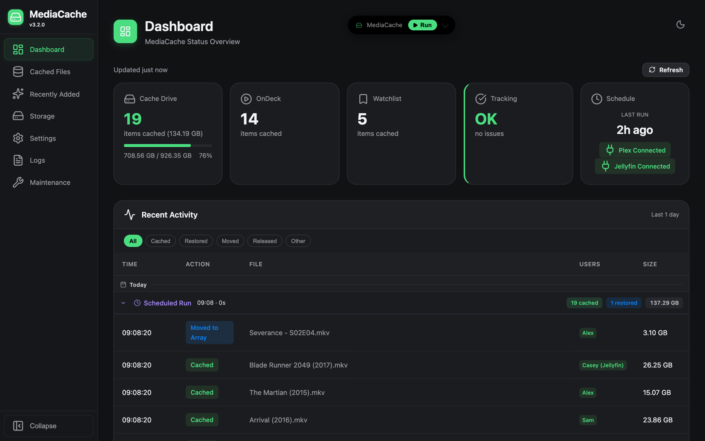
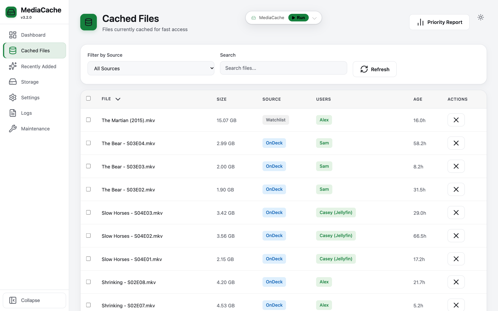
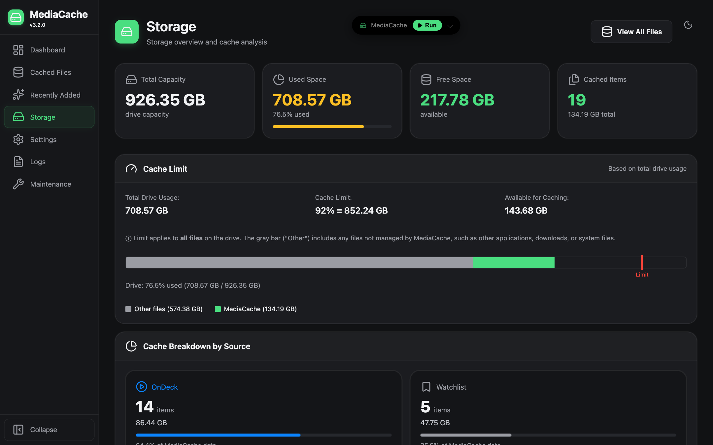
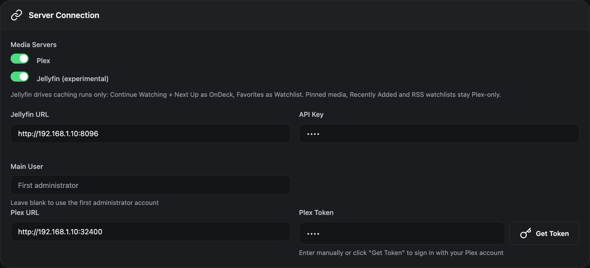
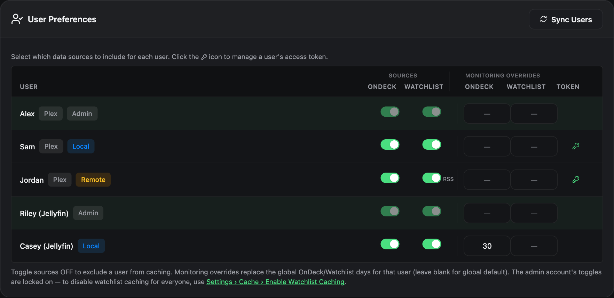

# MediaCache: Cache What You're About to Watch, for Plex and Jellyfin

MediaCache moves the media you're about to watch onto your fast cache drive, so your array can
stay spun down, then moves watched media back. It works with **Plex**, with **Jellyfin**
(experimental), or with **both at the same time**.

It's a fork of [PlexCache-D](https://github.com/StudioNirin/PlexCache-D) by StudioNirin, itself
built on [PlexCache](https://github.com/bexem/PlexCache) by bexem.

- **Image:** `ghcr.io/bbergle/mediacache:latest`
- **Unraid template:** [BBergle/unraid-templates › mediacache](https://github.com/BBergle/unraid-templates/tree/main/mediacache)
- **Issues:** [BBergle/MediaCache/issues](https://github.com/BBergle/MediaCache/issues)



<sub>Screenshots use demo data.</sub>

## Overview

MediaCache reduces energy use and array spin-ups when you watch recurring media like TV series.
It watches what your users have on deck or on their watchlist and copies those files to the cache
drive, fetching the next few episodes of a show ahead of time. Once nobody needs a file any more,
it goes back to the array.

**Built for Unraid, and runs on other Linux systems too.** On Unraid it uses the cache pool, the
array and the mover directly. On other Linux setups it works with any fast drive plus slower
storage; see [Other Linux systems](#other-linux-systems).

## Features

- **What it caches:** OnDeck and Watchlist media for you and your other users, with the next few
  episodes of a show fetched ahead of time.
- **Plex, Jellyfin, or both:** with both, an episode wanted on either server is cached once and
  stays on cache until nobody needs it.
- **Moving back:** watched media goes back to the array with its subtitles and artwork. Retention
  rules and eviction keep the cache drive from filling up.
- **Web UI:** a dashboard, cached-file browser, storage view, maintenance tools, live logs and scheduled runs.
- **Notifications:** Unraid, Discord and Slack.
- **Unraid integration:** a mover exclusion file, so the mover leaves cached files alone.

| Cached files (light mode) | Storage |
|---|---|
|  |  |

## Installation

There are three ways to run MediaCache:

| | Docker | Manual + Web UI | Manual + CLI |
|---|---|---|---|
| **Best for** | Unraid users who prefer containers | Unraid/Linux users who prefer native installs | Lightweight, script-only usage |
| **Web dashboard** | Yes (always on) | Yes (always on) | No |
| **Scheduling** | Built-in (via Web UI) | Built-in (via Web UI) | External (cron / User Scripts) |
| **Auto-start** | Docker restart policy | systemd or User Scripts plugin | cron `@reboot` or User Scripts |
| **Default port** | 5757 | 5000 | N/A |
| **Setup** | Web UI wizard on first visit | Web UI wizard on first visit | `--setup` CLI wizard |

### Option 1: Docker on Unraid (recommended)

**From Community Applications:** search for **MediaCache** and install it.

**If it isn't listed yet,** add the template by hand:
1. Go to **Docker → Add Container**.
2. Paste this into **Template**:
   `https://raw.githubusercontent.com/BBergle/unraid-templates/main/mediacache/mediacache.xml`

The template sets everything up:

| Container | Host (default) | Notes |
|---|---|---|
| `/config` | `/mnt/user/appdata/mediacache` | Settings, logs, tracking data, mover exclude list |
| `/mnt/cache` | `/mnt/cache` | Read-write |
| `/mnt/user0` | `/mnt/user0` | Read-write (array access, `.plexcached` backups) |
| `/mnt/user` | `/mnt/user` | Read-write (resolving library paths) |
| Port `5757` | `5757` | Web UI |

> **Important:** the `/mnt/cache`, `/mnt/user0` and `/mnt/user` paths must be **read-write** and
> must match exactly between container and host, so library paths resolve correctly.

`:latest` follows the `main` branch. Turn on updates for the container in CA Auto Update if you
want new versions automatically.

#### Migrating from PlexCache-D

1. Stop and remove the PlexCache-D container.
2. Install MediaCache, and point **Config** at PlexCache-D's existing appdata folder
   (usually `/mnt/user/appdata/plexcache`).

Your settings, cache tracking and the mover exclude file carry over. Mover Tuning keeps working,
because the exclude file stays where it was.

#### Plain `docker run`

```bash
docker run -d \
  --name mediacache \
  -p 5757:5757 \
  -v /mnt/user/appdata/mediacache:/config \
  -v /mnt/cache:/mnt/cache \
  -v /mnt/user0:/mnt/user0 \
  -v /mnt/user:/mnt/user \
  -e PUID=99 \
  -e PGID=100 \
  -e TZ=America/New_York \
  ghcr.io/bbergle/mediacache:latest
```

#### First run

Open `http://[YOUR_IP]:5757`. The setup wizard walks you through:
- connecting your media server (Plex via sign-in or token, or Jellyfin via URL and API key);
- choosing libraries and which are cacheable;
- choosing which users to monitor;
- caching behaviour;
- optional security.

To use **both** servers, set one up in the wizard, then switch the other on under
**Settings → Media Server** (see [Plex and Jellyfin](#plex-and-jellyfin)).

`docker/UNRAID_SETUP.md` has more Unraid detail, including CA Mover Tuning. It was written for
PlexCache-D, but the paths and steps are the same.

### Option 2: Manual install + Web UI

This runs MediaCache as a persistent web server, with the dashboard, scheduler and every feature.

**Prerequisites:** Python 3.9+ and Git.

```bash
cd /mnt/user/appdata
git clone https://github.com/BBergle/MediaCache.git
cd MediaCache
pip3 install -r requirements.txt
python3 plexcache.py --web --host 0.0.0.0              # All interfaces, port 5000
python3 plexcache.py --web --host 0.0.0.0 --port 8080  # Custom port
```

Open `http://[YOUR_IP]:5000`. On first run the setup wizard guides you through configuration.

#### Auto-start on boot (Unraid User Scripts)

1. Install **User Scripts** from Community Applications.
2. Go to **Settings → User Scripts → Add New Script**, name it `MediaCache Web UI`, and use:

```bash
#!/bin/bash
cd /mnt/user/appdata/MediaCache
nohup python3 plexcache.py --web --host 0.0.0.0 --port 5000 > /dev/null 2>&1 &
```

3. Set the schedule to **At Startup of Array**.

> **Tip:** to stop it, find the process with `ps aux | grep plexcache` and `kill` it.

#### Auto-start on boot (Linux systemd)

```ini
# /etc/systemd/system/mediacache.service
[Unit]
Description=MediaCache Web UI
After=network.target

[Service]
Type=simple
WorkingDirectory=/opt/MediaCache
ExecStart=/usr/bin/python3 plexcache.py --web --host 0.0.0.0 --port 5000
Restart=on-failure
RestartSec=10

[Install]
WantedBy=multi-user.target
```

```bash
sudo systemctl daemon-reload
sudo systemctl enable --now mediacache
```

Check it with `sudo systemctl status mediacache` and `journalctl -u mediacache -f`.

### Option 3: Manual install + CLI only

This mode has no web server or dashboard. MediaCache runs once, caches and evicts, then exits. You
schedule it yourself.

Install the same way as Option 2, then:

```bash
python3 plexcache.py --setup              # First-time setup
python3 plexcache.py                      # Normal run
python3 plexcache.py --dry-run --verbose  # Test run with full debug output
```

**Cron, every 6 hours:**
```
0 */6 * * * cd /mnt/user/appdata/MediaCache && python3 plexcache.py >> /mnt/user/appdata/MediaCache/logs/cron.log 2>&1
```

**Unraid User Scripts:** add a script with this content, and give it a custom schedule such as
`0 */6 * * *`.
```bash
#!/bin/bash
cd /mnt/user/appdata/MediaCache
python3 plexcache.py
```

> The entry point is still called `plexcache.py`, and the settings file is still
> `plexcache_settings.json`, so existing installs and scripts keep working.

### Other Linux systems

MediaCache is designed for Unraid, but it also runs on other Linux systems, either in Docker or
with Option 2 or 3 above. MediaCache detects when it isn't on Unraid.

When a file is cached, the original is renamed to `.plexcached`. On Unraid your media server keeps
finding the file at its usual path, because Unraid shows the cache copy there. Elsewhere, pick the
setup that matches yours:

- **Media and cache merged into one view** (mergerfs or similar): this works the same way as
  Unraid. No extra setting is needed.
- **Media and cache are separate folders:** turn on **Settings → Cache → Create Symlinks After
  Caching**. This leaves a link at the original path pointing to the cached copy, so Plex and
  Jellyfin still find the file. If it's off, MediaCache logs a warning at startup.

The Unraid mover exclude file and Unraid notifications only apply on Unraid. Discord and Slack
notifications work everywhere.

## Plex and Jellyfin

Under **Settings → Media Server**, switch on **Plex**, **Jellyfin**, or both. Each server has its
own connection fields and **Test Connection** button. The dashboard shows whether each enabled
server is connected.



**How Jellyfin maps to MediaCache:**
- **OnDeck** = Continue Watching + Next Up, plus the next `number_episodes`.
- **Watchlist** = Favorites. Favorite a series to cache its next unwatched `watchlist_episodes`.
- **Main user** = the Jellyfin user you set, or the first administrator if you leave it blank.
- **Requires** Jellyfin 10.9+, and an API key from Jellyfin's **Dashboard → API Keys**.

### Running both at the same time

1. **Connect both servers** under **Settings → Media Server**.
2. **Add a path mapping for each server.** Plex and Jellyfin usually mount the same media at
   different container paths, e.g. `/data/tv` for Plex and `/media/tv` for Jellyfin. Under
   **Settings → Libraries**, add a mapping for each, both pointing at the same real folder
   (e.g. `/mnt/user/tv/`).
   - Files are matched on that real path, so an episode wanted on both servers is cached once.
   - A shared folder counts as cacheable if any of its mappings says so.
   - Settings warns you when two mappings for the same folder disagree.
3. **Sync users.** Under **Settings → Users**, click **Sync Users**. Users from both servers are
   listed, and Jellyfin users are named `"<name> (Jellyfin)"`, e.g. `"Ben (Jellyfin)"`. Each person
   gets their own skip and retention settings.

   

**How it behaves:**
- **A file stays on cache while anyone on either server still needs it.** Watching an episode on
  Plex won't move it back while someone on Jellyfin still has it up next or in their favourites,
  and the other way round.
- **If a server is unreachable,** that run still caches what the other server asks for. But
  nothing is moved back or evicted, and the missing server's users and retention clocks are kept
  until it returns.
- **Switching a server off in Settings** means you no longer need its files cached. They move back
  on the next run as usual. Its users' settings are kept, in case you switch it back on.

**Plex-only features:** these work whenever Plex is enabled:
- pinned media;
- Recently Added;
- upgrade detection;
- the duplicate finder;
- remote-user RSS watchlists;
- Plex OAuth sign-in.

The setup wizard sets up one server at a time.

**CLI / settings file:**

```json
"media_server": "both",
"PLEX_URL": "http://192.168.1.10:32400",
"PLEX_TOKEN": "<your Plex token>",
"jellyfin_url": "http://192.168.1.10:8096",
"jellyfin_api_key": "<Dashboard > API Keys>",
"jellyfin_user": ""
```

`media_server` can be `"plex"` (the default), `"jellyfin"` or `"both"`. With `"jellyfin"` alone,
`PLEX_URL` and `PLEX_TOKEN` aren't needed.

## Project Structure

```
MediaCache/
├── plexcache.py              # Entry point (CLI, Web UI, setup wizard)
├── core/
│   ├── app.py                # Main orchestrator (PlexCacheApp)
│   ├── config.py             # Settings (dataclasses, JSON)
│   ├── media_servers.py      # Enabled servers, per-server usernames, CombinedMediaManager
│   ├── plex_api.py           # Plex: OnDeck, Watchlist, RSS
│   ├── jellyfin_api.py       # Jellyfin: Continue Watching, Next Up, Favorites
│   ├── file_operations.py    # Moves, filtering, path mappings, trackers
│   ├── logging_config.py     # Logging and notifications
│   ├── system_utils.py       # OS detection and path utilities
│   └── setup.py              # CLI setup wizard
├── web/                      # Web UI (FastAPI + HTMX + Jinja2)
│   ├── routers/              # Dashboard, cache, settings, logs, maintenance, setup
│   ├── services/             # Business logic (cache, settings, scheduler, runners)
│   ├── templates/            # Jinja2 templates
│   └── static/               # CSS (Graphite + Mint theme), JS, icons
├── docker/                   # Dockerfile, entrypoint, Unraid notes
├── tools/                    # Diagnostic utilities (audit_cache.py)
├── docs/                     # Design notes and plans
├── data/                     # Runtime tracking files (auto-created)
├── logs/                     # plexcache.log (rotating)
└── plexcache_settings.json   # Your configuration
```

## Known Limitations

### Remote/Network Storage

**The `.plexcached` backup system does NOT work with remote or network-attached storage**
(e.g. a Synology NAS mounted via SMB/NFS):
- the Unraid mover only moves files on the local array, not remote mounts;
- `.plexcached` backups on remote storage don't protect against anything;
- a remote NAS is usually always on anyway, so there's no spin-up saving.

**Recommendation:** mark libraries on remote storage as **non-cacheable** in the setup wizard or
settings.

### Dynamix File Integrity False Positives

If you use the **Dynamix File Integrity** plugin on Unraid, you may see "SHA256 hash key mismatch"
errors for files MediaCache manages. **These are false positives, not corruption.**

Dynamix records hashes by filename (e.g. `movie.mkv`). MediaCache keeps the array copy as
`movie.mkv.plexcached` while the file is on cache, so Dynamix can't find the original name. The
contents are unchanged: the cache copy and the `.plexcached` backup hash identically.

**Fix:** exclude `*.plexcached` files from Dynamix scanning, rebuild the Dynamix hash database
after MediaCache has been running, or exclude the directories MediaCache manages.

## Notes

MediaCache is mainly tested on Unraid, with Plex and Jellyfin running as Docker containers. Other
Linux systems are supported too (see [Other Linux systems](#other-linux-systems)). The setup
wizard is the recommended way to configure it. For help,
open an [issue](https://github.com/BBergle/MediaCache/issues). The upstream
[PlexCache-D wiki](https://github.com/StudioNirin/PlexCache-D/wiki) also covers most features in depth.

## Disclaimer

This software comes without any warranties, guarantees, or magic powers. By using it, you accept
that you're responsible for any consequences. The authors will not be held liable for data loss,
corruption, or any other problems you may encounter. Make sure you have backups, and test it
thoroughly (try `--dry-run`) before you unleash it.

## Acknowledgments

MediaCache stands on a long line of work:
- **brimur**[^3]: the original script that inspired the project.
- **bexem**[^4]: PlexCache.
- **bbergle**[^5]: the refactor into understandable modules.
- **StudioNirin**: PlexCache-D, which made the Plex API work for real-world multi-user setups and
  built the Web UI, Docker image and Unraid template this fork builds on.
- **[Brandon-Haney](https://github.com/Brandon-Haney)**: a large number of contributions to PlexCache-D.

Licensed under the MIT License; see `LICENSE.txt`.

[^3]: [brimur/preCachePlexOnDeckEpiosodes.py](https://gist.github.com/brimur/95277e75ca399d5d52b61e6aa192d1cd)
[^4]: https://github.com/bexem/PlexCache
[^5]: https://github.com/BBergle/MediaCache (formerly BBergle/PlexCache)
